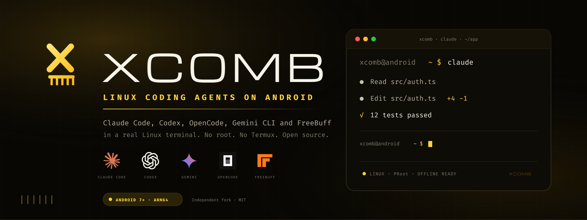
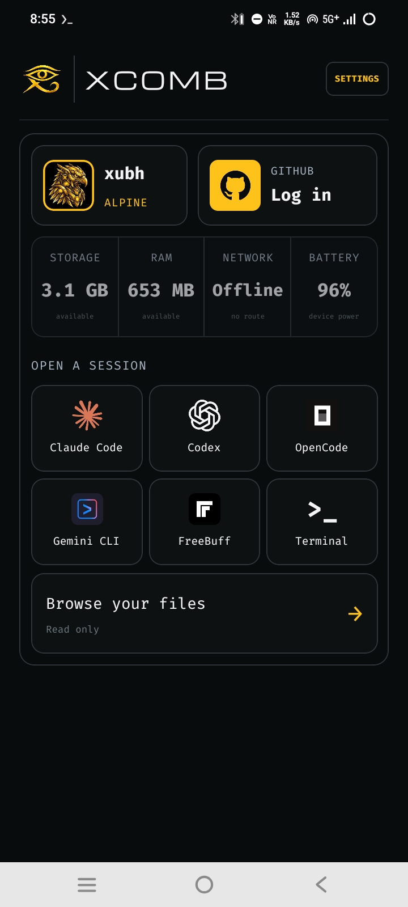
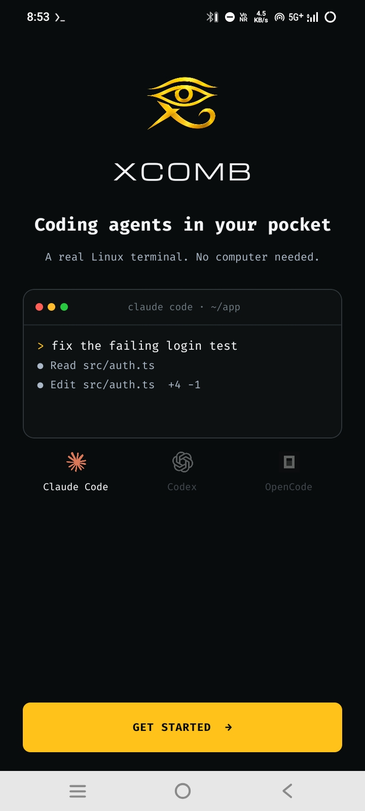
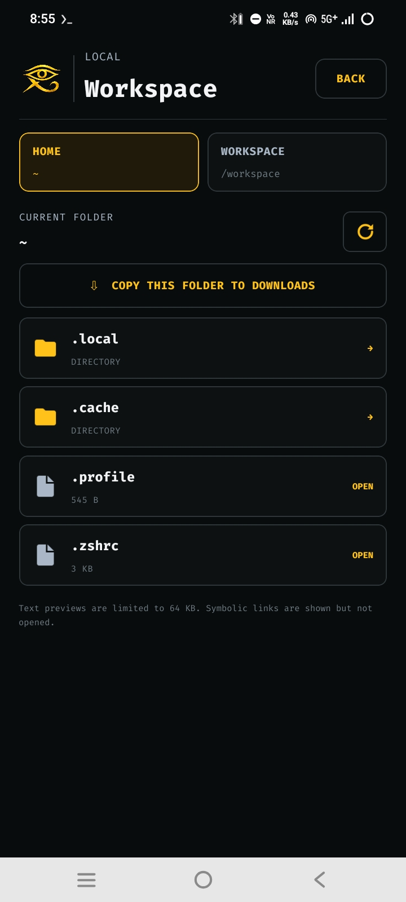
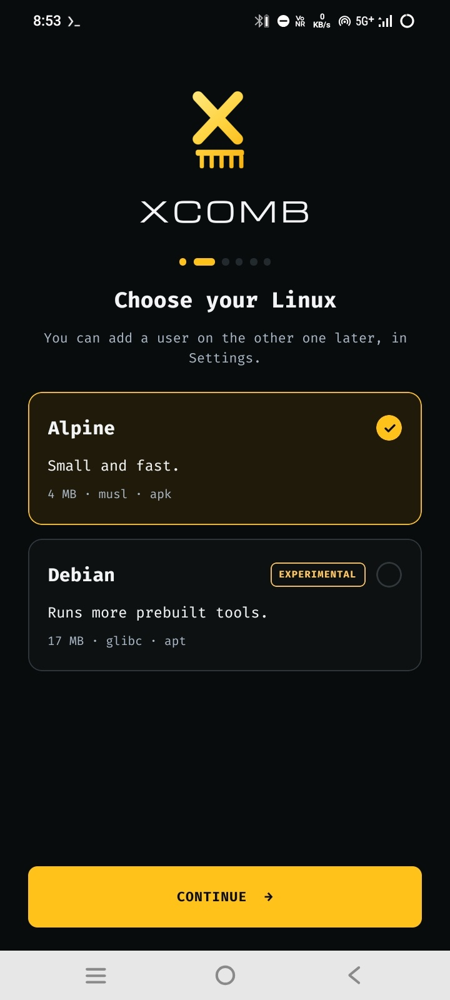
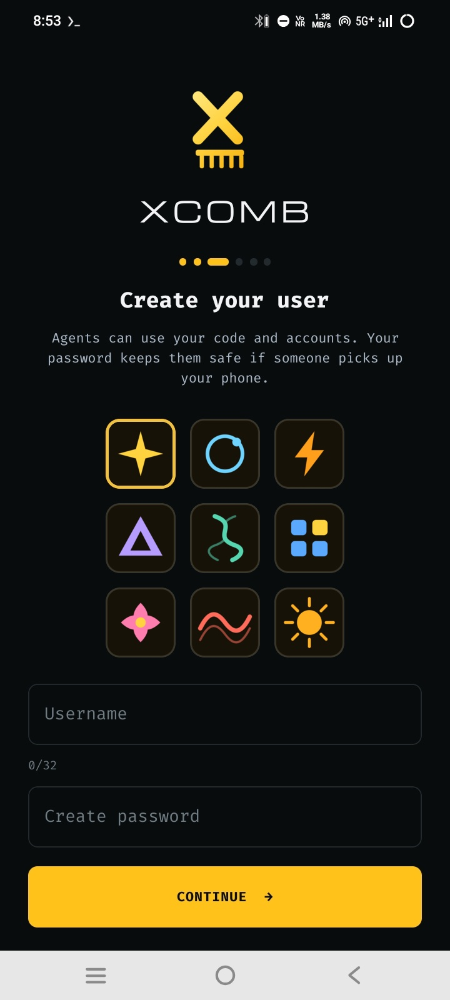
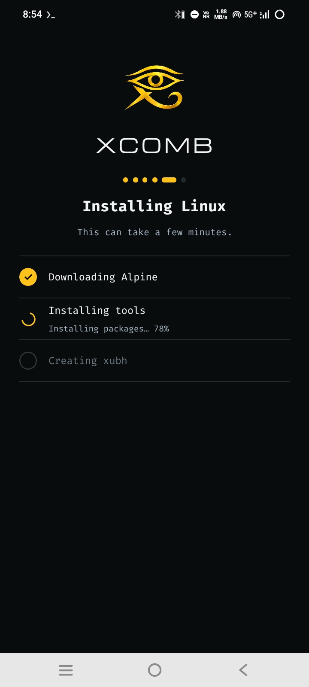
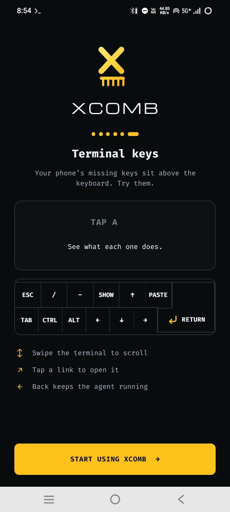

<div align="center">

<p></p>

<br>

**Claude Code, Codex, OpenCode, Gemini CLI and FreeBuff in a real Linux terminal on your Android phone.**

No root. No Termux. Open source.

<a href="https://github.com/quitsaurabhverma2008-sketch/xcomb/releases/latest"></a>

[](https://github.com/quitsaurabhverma2008-sketch/xcomb/actions/workflows/build-apk.yml)
[](https://github.com/quitsaurabhverma2008-sketch/xcomb/releases/latest)
[](https://github.com/quitsaurabhverma2008-sketch/xcomb/releases/latest)
[](LICENSE)

[Download APK](https://github.com/quitsaurabhverma2008-sketch/xcomb/releases/latest) · [Build from source](#build-from-source) · [Issues](https://github.com/quitsaurabhverma2008-sketch/xcomb/issues) · [Contributing](CONTRIBUTING.md)

<br>

&nbsp;
&nbsp;


<br>

&nbsp;
&nbsp;
&nbsp;


</div>

<br>

XComb turns your Android phone into a complete ARM64 Linux workspace. It
unpacks Alpine Linux inside the app, opens a real terminal, and puts the coding
agents one tap away: **Claude Code**, **Codex**, **OpenCode**, **Gemini CLI**,
**FreeBuff**, or a plain zsh shell. Point an agent at a project and let it work;
sessions keep running with the screen off.

No root. No Termux. No computer. Everything runs on the phone, in the app
sandbox, with a warm black and yellow interface built for a touch screen.

## About this project

XComb is an independent project, owned and maintained in full by its author.
This repository contains the complete XComb source. The project is **not built
from any secret, leaked, or confidential source**, and no proprietary
third-party source code is included. XComb is released under the
[MIT license](LICENSE).

## Highlights

| | |
| :-- | :-- |
| **Real Linux** | Alpine Linux ARM64, unpacked from a pinned minirootfs and checked against SHA-256 before it runs. `git`, `curl`, `jq`, `rg`, `python3`, Node and `apk add` work like a normal box. |
| **A terminal that behaves** | Native PTY and renderer with resize, Ctrl-C, and job control. The key bar adds Esc, Tab, arrows, paste, and sticky Ctrl/Alt for everything a phone keyboard leaves out. Select text with the COPY key or a long-press. |
| **A browser built in** | Tap the yellow three-dot menu at the top-left of the terminal, then choose **Split screen** (browser on top, terminal below, with a draggable divider) or **Small window** (a floating browser you can move and resize). Local http(s) dev servers, `about:`, `data:` and other URL types load; localhost links in the terminal open here too. |
| **Full file manager** | Browse **Phone storage**, **Linux home**, **Workspace** and **Favorites**. Search, sort by name/date/size, multi-select, copy, cut, paste, rename, delete, share, zip, unzip, import from the phone picker, and edit text files in place. |
| **Phone storage for agents** | Grant **All files access** and XComb binds `/sdcard` into Linux. Agents can then read and write the phone files you choose, and the same storage is available in the file manager. |
| **Config editor** | Swipe right from HOME to **CONFIG**. Each tool folder opens in the file manager, locked to that folder, so you can edit `.opencode`, `.claude`, `.codex`, `.freebuff`, `.gemini` and `.omniroute` files without leaving XComb. |
| **Omni Router connector** | Swipe to **CONNECTORS**. Open Omni Router; XComb installs and starts it, then opens its dashboard in a small browser window. |
| **Five agents, one tap** | Claude Code, Codex, OpenCode, Gemini CLI and FreeBuff each install on first open, with the installer output right in the terminal. |
| **Sessions that survive** | Terminals run in a foreground service in their own process. Lock the phone or close the UI; the agent keeps working and notifies you when it needs an answer. |
| **Your projects** | Create a folder, clone any HTTPS or SSH Git URL, or sign in to GitHub and pick from your repositories. Everything lives under `/workspace/projects`. |
| **Private by default** | No analytics, ads, crash reporting, or Google services. An optional password locks the app after 15 minutes in the background. |
| **Optional remote access** | Pair a computer over USB for an SSH shell on the phone. Off by default, loopback only, key-only logins. |

## Supported agents

| Agent | What it is | Installed by XComb |
| :-- | :-- | :-- |
|  **Claude Code** | Anthropic's terminal coding agent | First open |
|  **Codex** | OpenAI's terminal coding agent | First open |
|  **OpenCode** | Open-source terminal coding agent | First open |
|  **Gemini CLI** | Google's terminal AI assistant | First open |
|  **FreeBuff** | Free, ad-supported coding agent from Codebuff | First open |
| **Bare terminal** | zsh in the Linux guest | Built in |

Each agent gets its own Linux user and private home. All agent users share the
`/workspace` group so they can work on the same projects. Sign-in credentials
stay inside each CLI; XComb never handles provider passwords.

## Install

### Download the APK

1. Open the [latest release](https://github.com/quitsaurabhverma2008-sketch/xcomb/releases/latest).
2. Download **`XComb_1.1.5.apk`**.
3. **Uninstall any older build first.** CI builds are signed with a per-run
   throwaway key, so Android refuses to update an app signed by another key.
   This release also uses a new application ID, so it installs as a fresh app.
   The old app stays separate and its data is not migrated. Export anything you
   need from `/workspace` before uninstalling.
4. Open the APK, allow installs from your browser or file manager, and install.
5. Launch XComb and create your Linux user.

You need an **ARM64** phone (`arm64-v8a`) on **Android 7.0** or newer. The first
launch downloads Alpine Linux and verifies it before unpacking.

> **Data warning:** uninstalling the app removes its private storage, including
> `/workspace` and every agent home. Copy important projects into
> `Download/XComb` with the file manager before uninstalling.

### First run

1. Pick a username and an optional app password.
2. Wait for Alpine to download and unpack (about a minute on Wi-Fi).
3. Tap an agent tile. XComb installs that CLI the first time you open it.
4. Sign in inside the CLI. XComb never sees the provider password.
5. Create or clone a project under `/workspace/projects`.
6. Open **Files** and tap **GRANT** if you want the file manager and agents to
   use phone storage. You can also grant or revoke it later in Android Settings.

## Using XComb

### Home

The home screen shows your Linux user, GitHub account, storage, RAM, network and
battery state, the six session tiles, and any sessions that are already running.
**Settings** is in the top right; **Browse your files** opens the full file
manager.

### File manager

Tap **Files** from the home screen or a session.

- **Tabs:** Phone storage, Linux home, Workspace, and Favorites. The CONFIG page
  also opens the manager locked to a tool's folder.
- **Search and sort:** search below the current folder; sort by name, date, or
  size in list view.
- **File actions** (⋮): Open as archive (zip, jar, apk), Compress (zip),
  Information, Copy, Cut, Delete, Rename, Share, and Add to Favorites.
- **Plus menu:** New folder, New file, New archive, and Import from phone.
- **Multi-select:** long-press a file or folder, then copy, cut, zip, delete, or
  share several items together. A paste bar appears when the clipboard has
  files.
- **Text editing:** tap a text file, edit it, and save in place.
- **Storage access:** if phone storage is not available, the banner's **GRANT**
  button opens Android's All files access screen.

Archive support is **zip only**; 7z and custom compression are not included.
Android/data and Android/obb remain restricted on modern Android versions even
after All files access is granted.

### Phone storage for agents

With All files access granted, XComb binds the shared phone storage to
`/sdcard` and `/storage/emulated/0` inside Linux. Agents can read and write the
files you choose from their terminals. The same files appear in the file
manager's **Phone storage** tab.

All files access is broad. Grant it only if you want agents and the file manager
to work on shared phone storage. XComb itself still keeps Linux files under its
private app storage and only accepts file-manager paths below its configured
roots.

### Connectors and config

Swipe right from HOME to **CONNECTORS**. Omni Router installs and starts on first
open, then its dashboard opens in a small browser window.

Swipe right again to **CONFIG**. Open the `.opencode`, `.claude`, `.codex`,
`.freebuff`, `.gemini` and `.omniroute` folders. Each opens in the file manager
locked to that tool's directory, where you can edit text files, create folders,
import files, zip, or delete items.

### Sessions

Up to four sessions can run at once, each with its own notification and its own
agent home. **STOP** on a session card ends it. Closing the UI does not end a
session: the terminal lives in a foreground service in the `:terminal` process.

### Projects and GitHub

Create an empty folder, clone an HTTPS or SSH URL, or sign in to GitHub with a
browser device login and pick a repository. Projects live under
`/workspace/projects` and are visible to every agent user.

### Settings

- **Appearance** — yellow theme and text size.
- **Terminal** — key bar, haptics, and scrollback.
- **Security** — app lock and the background lock timer.
- **Remote access** — pair or revoke computers.
- **About** — version, licenses, and source.

## Remote access (optional)

XComb works fully on the phone. If you also want to use it like a small cloud
VM, pair a computer over USB and open an SSH session to the phone:

- The SSH server listens on loopback only and reaches your computer through
  `adb forward`, so nothing is exposed on Wi-Fi.
- Logins are key-only. Root is refused.
- **Settings → Remote access** turns it off and lists paired computers you can
  revoke.

A companion CLI in [`cli/`](cli/README.md) handles pairing and port forwarding.

## Security and privacy

- **Android's app sandbox is the only real security boundary.** PRoot emulates
  user IDs but gives no kernel isolation between agent users, so don't run code
  you don't trust.
- **No telemetry.** There is no analytics, advertising, crash reporting, or
  Google services dependency. The diagnostic log stays on the device and records
  lifecycle metadata only, never terminal input or output.
- **Agent credentials stay inside each CLI.** XComb does not proxy or store
  provider passwords.
- **Codex sandbox note.** Codex's own Linux sandbox does not work under PRoot,
  so the shell wraps `codex` with `--sandbox danger-full-access`; Codex's
  approval prompts still apply.
- **Remote access is off until paired.** Any app on the phone can reach loopback
  ports, so the paired key is what keeps others out.
- **File-manager paths are restricted to configured roots.** The native bridge
  rejects paths outside phone storage and XComb's private Linux roots, and it
  refuses to delete a root itself.
- **All files access is optional and broad.** Grant it only when you want the
  file manager and agents to reach shared phone storage.

### Permissions

| Permission | Why |
| :-- | :-- |
| `INTERNET`, `ACCESS_NETWORK_STATE` | Download Alpine, packages and agents; show network state on the home screen |
| `FOREGROUND_SERVICE`, `FOREGROUND_SERVICE_SPECIAL_USE` | Keep terminal sessions running in a separate `:terminal` process while the UI is closed |
| `POST_NOTIFICATIONS` | One notification per running session, and "waiting for you" when an agent finishes a turn |
| `WAKE_LOCK` | Keep the CPU awake while a session is running |
| `REQUEST_IGNORE_BATTERY_OPTIMIZATIONS` | Asked for during setup so Android does not pause long agent runs |
| `VIBRATE` | Short haptic feedback on button taps |
| `WRITE_EXTERNAL_STORAGE` (API ≤ 28 only) | Copy files to `Download/XComb` on older Android versions |
| `READ_EXTERNAL_STORAGE` (API ≤ 32 only) | Read shared storage on Android versions before All files access |
| `MANAGE_EXTERNAL_STORAGE` (optional) | Full file manager and `/sdcard` for agents; granted from the Files banner or Android Settings |

## How it works

```
React Native UI (App.tsx, src/)
  │  TerminalRuntime TurboModule + TerminalCanvas / TerminalInput native views
  │  XCombFiles native module (file manager)
  ▼
Kotlin native layer (android/app/src/main/java/.../terminal)
  ├─ DistroStore*            rootfs download → verify → extract → promote
  ├─ ProotSessionLauncher    builds the PRoot command line and guest environment
  ├─ XCombFilesModule        file manager bridge: list, search, copy, zip, share
  ├─ FileOps                 java.io file operations used by the bridge and tests
  ├─ TerminalSessionService  foreground service in the :terminal process
  └─ NativeTerminalEngine / TerminalCanvasView  VT parsing and rendering
        │
        ▼
terminal_pty.c (JNI) ── PRoot (native/, built from source) ── Alpine rootfs
```

Each agent runs as its own guest user with a private home; all agent users share
workspace GID 1000. Phone storage is mounted at `/sdcard` only when All files
access is available.

## Build from source

### Prerequisites

- Node.js ≥ 22.11 (see `.node-version`)
- JDK 17
- Android SDK and NDK — the standard
  [React Native environment](https://reactnative.dev/docs/set-up-your-environment)
- `make`, `bash` and `git` for the native runtime

### Steps

```sh
git clone --recurse-submodules https://github.com/quitsaurabhverma2008-sketch/xcomb.git
cd xcomb
npm ci
npm run build:android:debug      # or build:android:release
adb install -r android/app/build/outputs/apk/debug/app-debug.apk
```

Cloned without `--recurse-submodules`? Run `git submodule update --init` to fetch
the pinned PRoot and libandroid-shmem sources.

Debug builds embed the JavaScript bundle, so they start without Metro. Release
builds stay unsigned unless you pass a keystore through the Gradle properties
declared in `android/app/build.gradle` (`xcomb.releaseStoreFile`,
`xcomb.releaseStorePassword`, `xcomb.releaseKeyAlias`, `xcomb.releaseKeyPassword`),
for example in `~/.gradle/gradle.properties`.

### GitHub Actions

The [Build XComb APK](.github/workflows/build-apk.yml) workflow builds a signed
release APK on manual dispatch and on pushes to the `xcomb-update` branch. It
installs Node and JDK 17, builds both native submodules, runs typecheck and Jest,
builds the Android release APK, and uploads it as the **xcomb-apk** artifact.

The workflow signs with a throwaway key generated per run (`CN=XComb`). That is
fine for sideloading and testing, but it means every CI APK is a fresh identity:
uninstall the previous build before installing a new one. For real updates, sign
release builds with your own long-lived keystore.

### Tests

```sh
npm run typecheck
npm run lint
npm run test:unit                # Jest (TypeScript / React Native)
npm run test:kotlin              # JVM unit tests for the native layer
npm run test:android:connected   # instrumented tests on a connected device
```

Typecheck and Jest run before the APK build. The workflow keeps the APK step
strict; the check step is reported separately so a type-only failure does not
hide a buildable APK.

## Troubleshooting

| Symptom | Fix |
| :-- | :-- |
| **"App not installed"** | An older build signed with a different key is still installed. Uninstall it first — app data will be removed. This release also has a new application ID, so it installs as a separate app. |
| **Phone storage is missing in Files** | Tap **GRANT** on the storage banner, allow All files access in Android Settings, then return to XComb. |
| **An agent cannot see `/sdcard`** | Grant All files access, then start a new session so the bind is applied. Android/data and Android/obb remain restricted. |
| **First launch is slow** | Alpine is downloading and verifying. Keep the phone on Wi-Fi and the app in the foreground. |
| **An agent fails to install** | Check the network and the package mirror in **Settings**. Reopen the tile to retry. |
| **Session stops when the screen locks** | Allow XComb to ignore battery optimizations and keep the foreground-service notification enabled. |
| **I need my files before uninstalling** | Copy important projects into `Download/XComb` with the file manager. |
| **No root / no Termux?** | Correct. XComb ships its own Linux runtime and needs neither. |
| **Which phones work?** | ARM64 (`arm64-v8a`), Android 7.0 (API 24) or newer. |

## Package identity

| | |
| :-- | :-- |
| App label | **XComb** |
| Application ID | New XComb application ID declared in [`android/app/build.gradle`](android/app/build.gradle) |
| Version | `1.1.5` (versionCode `11`) |
| ABI | `arm64-v8a` only |
| Min / target SDK | 24 / 36 |
| Source | <https://github.com/quitsaurabhverma2008-sketch/xcomb> |
| Releases | <https://github.com/quitsaurabhverma2008-sketch/xcomb/releases> |
| Issue tracker | <https://github.com/quitsaurabhverma2008-sketch/xcomb/issues> |
| License | [MIT](LICENSE); bundled components in [THIRD_PARTY_NOTICES.md](THIRD_PARTY_NOTICES.md) |

## Third-party build components

- **PRoot, talloc and libandroid-shmem** are compiled during the Gradle build by
  [`scripts/native/build-proot-runtime.sh`](scripts/native/build-proot-runtime.sh):
  - `native/proot`: submodule, [termux/proot](https://github.com/termux/proot) v5.1.107.92, GPL-2.0-or-later;
  - `native/libandroid-shmem`: submodule, [termux/libandroid-shmem](https://github.com/termux/libandroid-shmem) v0.7, BSD-3-Clause;
  - `native/talloc`: talloc 2.4.3 core sources, vendored, LGPL-3.0-or-later.
- **The PTY** is [`android/app/src/main/cpp/terminal_pty.c`](android/app/src/main/cpp/terminal_pty.c) (JNI).
- **Hermes bytecode compiler.** Gradle uses the prebuilt `hermesc` from
  `node_modules/hermes-compiler` by default.

No binaries are committed except `android/gradle/wrapper/gradle-wrapper.jar`.

**Runtime downloads:** a pinned Alpine minirootfs from `dl-cdn.alpinelinux.org`,
checked against a SHA-256 in
[`AlpineRootfsCatalog.kt`](android/app/src/main/java/.../terminal/AlpineRootfsCatalog.kt),
then Alpine packages, then each agent from its publisher the first time it is
opened.

Agent names and marks belong to their respective owners. See
[`src/terminal/harness-logos/README.md`](src/terminal/harness-logos/README.md)
for logo sources and licenses.

## Contributing

Use [Issues](https://github.com/quitsaurabhverma2008-sketch/xcomb/issues) for
reproducible bugs and concrete feature requests. Read
[Contributing](CONTRIBUTING.md), the
[Code of Conduct](.github/CODE_OF_CONDUCT.md), and the
[security policy](.github/SECURITY.md) before opening a pull request or reporting
a vulnerability.

## License

[MIT](LICENSE). Bundled third-party components (xterm.js, PRoot, talloc,
libandroid-shmem, fonts, agent marks) are listed with their licenses in
[THIRD_PARTY_NOTICES.md](THIRD_PARTY_NOTICES.md).

<div align="center">
<br>
<sub>XComb · Linux coding agents on Android</sub>
</div>
